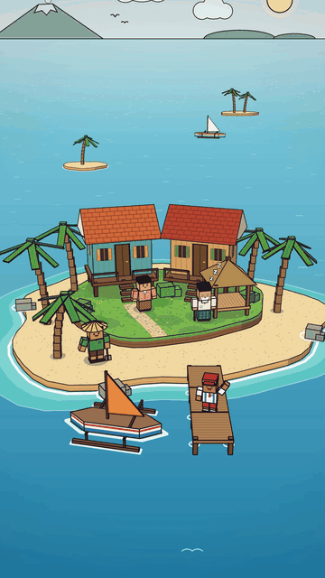
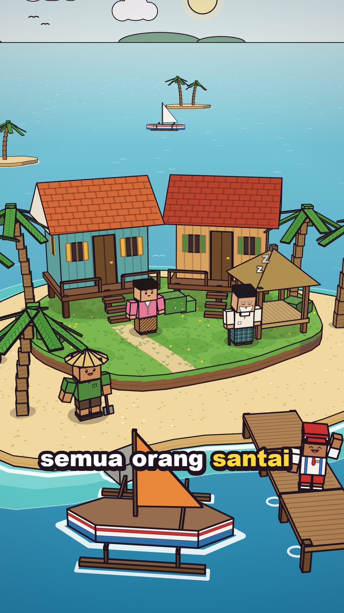
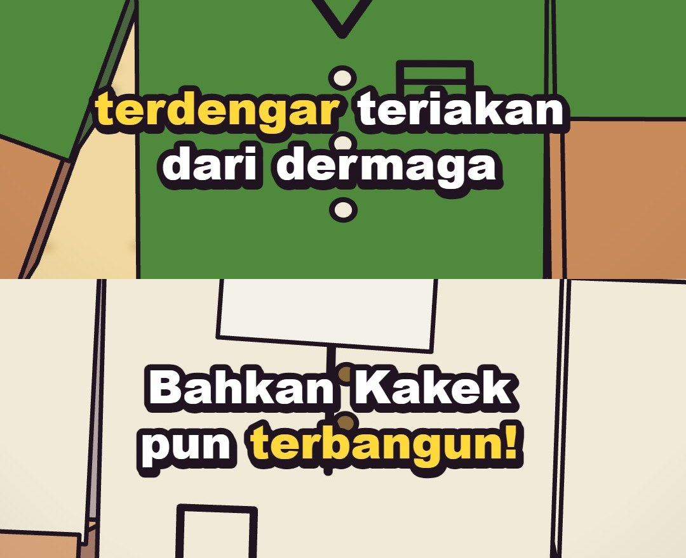
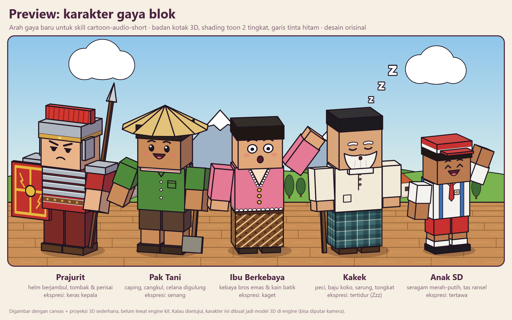
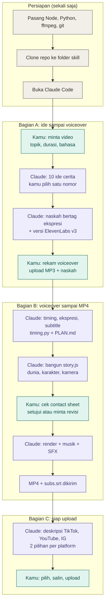

# animasi-roblox

Skill Claude **`cartoon-audio-short`** untuk membuat video kartun pendek vertikal (Shorts/Reels/TikTok, 1080×1920) bergaya **blok**: karakter berbadan kotak 3D di dunia pulau dan kampung dengan garis tinta hitam. Alurnya lengkap dari **ide → naskah bertag ekspresi → voiceover → MP4 jadi → deskripsi siap upload**, dengan subtitle otomatis, ekspresi karakter yang mengikuti naskah, musik dan SFX yang dibuat otomatis di 50 % level suara, serta teks unggahan untuk TikTok, YouTube, dan Instagram.

> Desain karakter dan dunia di repo ini orisinal bergaya blok. Repo ini tidak berafiliasi dengan, dan tidak memakai aset dari, Roblox Corporation atau game lain.

## Contoh hasil

<p align="center">
  
  &nbsp;&nbsp;
  
</p>
<p align="center"><sub>Kiri: animasi contoh (GIF 15 fps, diperkecil). Kanan: satu frame penuh 1080×1920. Keduanya dirender langsung oleh engine dari <code>kit/example/pulau/story.js</code> dengan naskah contoh di bawah.</sub></p>

### Shot demi shot


1. **Establishing:** kamera meluncur di atas pulau. Ibu berkebaya sedang mengobrol, kakek tertidur dengan efek Zzz, perahu bergoyang, dan daun kelapa melambai.
2. **Reaksi Pak Tani:** close-up dengan latar diburamkan (DOF). Tag `[kaget]` di naskah membuatnya menoleh dengan gerakan *overshoot* dan berubah jadi kaget tepat di kata "terdengar".
3. **Dermaga:** Anak SD berlari ke arah kamera (siklus jalan), lalu melambai sambil tertawa.
4. **Kakek bangun:** push-in pelan. Tag `[Kakek: kaget]` membuatnya terbangun dengan hentakan tepat di kata "terbangun", kamera sedikit bergetar, dan Zzz menghilang.

## Subtitle dan tag ekspresi

Naskah ditulis dengan **tag ekspresi** dalam kurung siku. Tag tidak diucapkan dan tidak muncul di subtitle, tapi mengatur wajah karakter (otomatis, tepat di kata yang ditandai) dan cara bicara narator.

```text
[senang] Di pulau kecil ini, semua orang santai. Sampai suatu hari, [kaget] terdengar teriakan dari dermaga.
Bahkan Kakek pun [Kakek: kaget] terbangun!
```

- `[kaget]` → suara narator + wajah tokoh utama shot itu. `[Kakek: kaget]` → hanya wajah Kakek.
- Tag wajah: `senang`, `tertawa`, `kaget`, `marah`, `sedih`, `ngotot`, `ngantuk`, `datar` (plus sinonim). Hanya arahan suara: `berbisik`, `misterius`, `tegang`, `menghela napas`, `sarkastis`, `dramatis`.
- `python kit/tools/naskah.py naskah.txt` mencetak versi **ElevenLabs v3** (tag jadi `[happy]`, `[surprised]`, yang dibaca model v3 sebagai emosi) dan versi bersih tanpa tag, plus jumlah kata dan perkiraan durasi.

<p align="center">
  
</p>
<p align="center"><sub>Subtitle dibakar ke video: 2-4 kata per potongan, terbagi dua baris dengan seimbang, kata yang sedang diucapkan menyala kuning. File <code>out/subs.srt</code> juga dibuat untuk diupload ke platform.</sub></p>

### Pemeran



<p align="center">
  
</p>
<p align="center"><sub>Test sheet dari engine (<code>HASH=#sheet node render.mjs stills/sheet "0"</code>): enam preset (Prajurit, Pak Tani, Ibu Berkebaya, Kakek, Anak SD, Warga) dan contoh ekspresi.</sub></p>

## Alur pemakaian

Kotak hijau dikerjakan orang yang memakai skill, kotak ungu dikerjakan Claude secara otomatis. Kalau voiceover dan naskahnya sudah ada, bagian A bisa dilewati. Setelah MP4 jadi, Claude langsung mengirim teks deskripsi per platform (bagian C).



**Perkiraan waktu:** ide sampai naskah beberapa menit. Render gaya blok ±1-4 detik per frame (+±40 detik untuk menyalakan browser), jadi video 20 detik (600 frame) ±10-40 menit. Suara dan MP4 akhir biasanya kurang dari satu menit.

## Cara pakai

1. **Pasang kebutuhan** (contoh Windows; Edge sudah ada, Playwright tidak wajib):
   ```powershell
   winget install OpenJS.NodeJS.LTS Python.Python.3.12 Gyan.FFmpeg Git.Git
   pip install numpy pillow
   ```
2. **Pasang sebagai skill Claude Code:**
   ```bash
   git clone https://github.com/ilham-mulia/animasi-roblox ~/.claude/skills/cartoon-audio-short
   ```
3. **Minta ke Claude**, misalnya "bikinin video kartun pendek tentang ...". Skill akan memandu dari 10 ide, naskah bertag, voiceover, sampai MP4 jadi.

Pemakaian manual (tanpa Claude):
```bash
python kit/tools/naskah.py naskah.txt --lang id    # cek naskah bertag + versi ElevenLabs v3
bash kit/tools/setup.sh ~/shorts/pulau             # buat project (gaya blok, offline, berisi demo)
cd ~/shorts/pulau
HASH='#sheet' node render.mjs stills/sheet "0"      # test sheet karakter
node render.mjs stills/a "0,90,150,205"            # beberapa still (demo sudah bersubtitle)
python timing.py voice.mp3 script.txt --out work --lang id   # timing, ekspresi, subtitle dari voiceover asli
```
Langkah lengkapnya (`story.js` → `render.mjs` → `audio.py` → `mix.py` → `finish.sh`) ada di [`SKILL.md`](SKILL.md).

## Fitur

- **Karakter bisa digerakkan:** berjalan, melambai, menoleh, mengangguk, berkedip, bernapas, dan memegang properti (tombak, cangkul, tongkat). Tersedia 9 ekspresi: `neutral, happy, talk, laugh, surprised, stubborn, angry, sad, sleep`.
- **Ekspresi dari naskah:** tag `[kaget]`/`[Kakek: kaget]` otomatis menjadi perubahan wajah plus "pop" kecil tepat di katanya.
- **Subtitle otomatis** gaya Shorts dengan sorotan per kata, plus file `.srt`.
- **Deskripsi siap upload** untuk TikTok, YouTube Shorts, dan Instagram Reels, masing-masing dua pilihan (A/B) di `out/deskripsi.md`; pengguna tinggal pilih dan salin. Contoh: [`kit/example/pulau/deskripsi.md`](kit/example/pulau/deskripsi.md).
- **Dunia siap pakai:** pulau bertingkat, rumah panggung, saung, pohon kelapa yang bergoyang, semak, batu, dermaga, dan perahu bercadik, plus langit (matahari, awan, burung, gunung berapi berasap) dan laut berombak yang mengikuti arah kamera.
- **Kamera sinematik:** glide halus, jalur melengkung, roll, guncangan saat benturan, lensa blur 2 lapis untuk close-up, dan flash saat pergantian shot.
- **Timing otomatis** dari naskah (bahasa Indonesia dan Inggris), lalu musik dan SFX dari synth dengan mix yang dikunci di −6 dB terhadap suara.
- **Render offline:** tanpa three.js dan tanpa GPU. `render.mjs` memakai Playwright kalau ada, atau langsung Edge/Chrome yang sudah terpasang.
- **Gaya lama** (karakter 2D "bean-head" di dunia three.js) masih tersedia lewat `setup.sh <dir> card`.

## Struktur

```
SKILL.md                    alur lengkap skill (bahasa Indonesia)
contoh/                     gambar contoh untuk README
kit/engine-blok/            engine gaya blok: blok.js (karakter, mesh, decal, cue), world.js (dunia),
                            render.js (renderer canvas + subtitle), main.js, index.html
kit/engine/                 motion.js (helper gerak) + engine gaya card + GAYA-CARD.md
kit/example/pulau/          cerita contoh gaya blok: story.js, naskah.txt (bertag), cues.js + subs.js (timing demo),
                            deskripsi.md (contoh teks TikTok/YouTube/IG)
kit/example/soldier/        audio.py (template synth musik/SFX) + contoh gaya card
kit/tools/                  setup.sh, naskah.py, timing.py, render.mjs, sheet.py, mix.py, finish.sh
```

## Kredit

- Engine gaya card dan versi awal tools berasal dari *cartoon-short-kit*, yang dibangun di atas [mromidev/claude-animated-shorts](https://github.com/mromidev/claude-animated-shorts) (lisensi MIT). `toon.ts` dari proyek itu diunduh oleh `setup.sh` saat dibutuhkan dan tidak disertakan di repo ini.
- Engine gaya blok, kit dunia, cerita contoh pulau, subtitle, tag ekspresi, `naskah.py`, `mix.py`, dan perbaikan tools (Windows, timing bahasa Indonesia, render tanpa Playwright) dibuat untuk repo ini.
