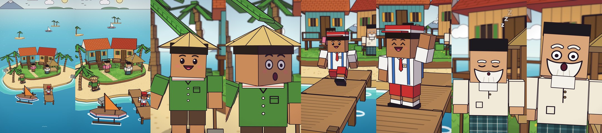
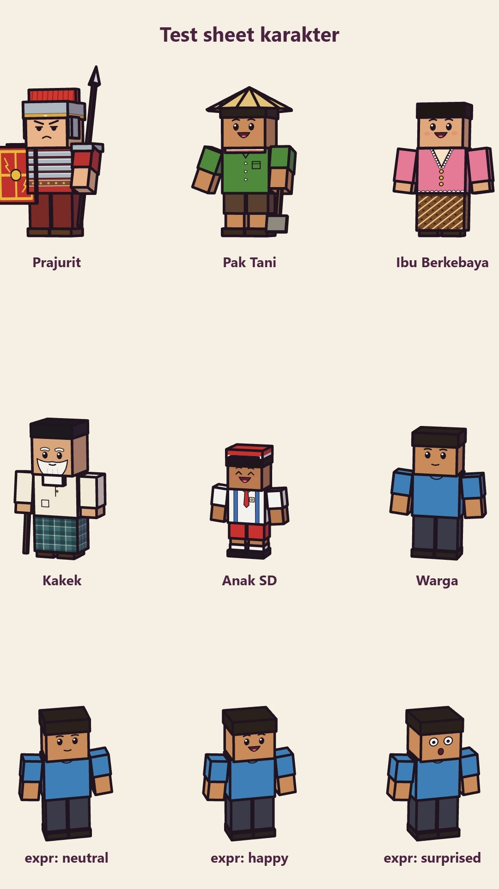

# animasi-roblox

Skill Claude **`cartoon-audio-short`** untuk membuat video kartun pendek vertikal (Shorts/Reels/TikTok, 1080×1920) bergaya **blok**: karakter berbadan kotak 3D di dunia pulau dan kampung dengan garis tinta hitam. Alurnya lengkap dari **ide → naskah → voiceover → MP4 jadi**, dengan musik dan SFX yang dibuat otomatis di 50 % level suara.

> Desain karakter dan dunia di repo ini orisinal bergaya blok. Repo ini tidak berafiliasi dengan, dan tidak memakai aset dari, Roblox Corporation atau game lain.

## Contoh hasil

<p align="center">
  
  &nbsp;&nbsp;
  
</p>
<p align="center"><sub>Kiri: animasi contoh (GIF 15 fps, diperkecil). Kanan: satu frame penuh 1080×1920. Keduanya dirender langsung oleh engine dari <code>kit/example/pulau/story.js</code>.</sub></p>

### Shot demi shot



1. **Establishing:** kamera meluncur di atas pulau. Ibu berkebaya sedang mengobrol, kakek tertidur dengan efek Zzz, perahu bergoyang, dan daun kelapa melambai.
2. **Reaksi Pak Tani:** close-up dengan latar diburamkan (DOF). Ia menoleh dengan gerakan *overshoot*, lalu ekspresinya berubah jadi kaget.
3. **Dermaga:** Anak SD berlari ke arah kamera (siklus jalan), lalu melambai sambil tertawa.
4. **Kakek bangun:** push-in pelan, lalu terbangun dengan hentakan (antisipasi → *overshoot*), kamera sedikit bergetar, dan Zzz menghilang.

### Pemeran


<p align="center">
  
</p>
<p align="center"><sub>Test sheet dari engine (<code>HASH=#sheet node render.mjs stills/sheet "0"</code>): enam preset (Prajurit, Pak Tani, Ibu Berkebaya, Kakek, Anak SD, Warga) dan contoh ekspresi.</sub></p>

## Fitur

- **Karakter bisa digerakkan:** berjalan, melambai, menoleh, mengangguk, berkedip, bernapas, dan memegang properti (tombak, cangkul, tongkat). Tersedia 9 ekspresi: `neutral, happy, talk, laugh, surprised, stubborn, angry, sad, sleep`.
- **Dunia siap pakai:** pulau bertingkat, rumah panggung, saung, pohon kelapa yang bergoyang, semak, batu, dermaga, dan perahu bercadik, plus langit (matahari, awan, burung, gunung berapi berasap) dan laut berombak yang mengikuti arah kamera.
- **Kamera sinematik:** glide halus, jalur melengkung, roll, guncangan saat benturan, lensa blur 2 lapis untuk close-up, dan flash saat pergantian shot.
- **Timing otomatis** dari naskah (bahasa Indonesia dan Inggris), lalu musik dan SFX dari synth dengan mix yang dikunci di −6 dB terhadap suara.
- **Render offline:** tanpa three.js dan tanpa GPU. Playwright opsional, karena `render.mjs` bisa langsung memakai Edge atau Chrome yang sudah terpasang.
- **Gaya lama** (karakter 2D "bean-head" di dunia three.js) masih tersedia lewat `setup.sh <dir> card`.

## Cara pakai

1. **Pasang sebagai skill Claude Code:**
   ```bash
   git clone https://github.com/ilham-mulia/animasi-roblox ~/.claude/skills/cartoon-audio-short
   ```
2. **Kebutuhan:** Node 22.6+, Python 3 + numpy + Pillow, ffmpeg + ffprobe, dan Edge atau Chrome.
3. **Minta ke Claude**, misalnya "bikinin video kartun pendek tentang ...". Skill akan memandu dari 10 ide, naskah, voiceover, sampai MP4 jadi.

Pemakaian manual (tanpa Claude):
```bash
bash kit/tools/setup.sh ~/shorts/pulau          # buat project (gaya blok, offline)
cd ~/shorts/pulau
HASH='#sheet' node render.mjs stills/sheet "0"   # test sheet karakter
node render.mjs stills/a "0,90,150,205"         # beberapa still
node render.mjs frames "0-239"                  # semua frame contoh
```
Untuk video dengan voiceover, ikuti alur di [`SKILL.md`](SKILL.md): `timing.py` → `story.js` → `render.mjs` → `audio.py` → `mix.py` → `finish.sh`.

## Struktur

```
SKILL.md                    alur lengkap skill (bahasa Indonesia)
contoh/                     gambar contoh untuk README
kit/engine-blok/            engine gaya blok: blok.js (karakter, mesh, decal), world.js (dunia),
                            render.js (renderer canvas), main.js, index.html
kit/engine/                 motion.js (helper gerak) + engine gaya card + GAYA-CARD.md
kit/example/pulau/          cerita contoh gaya blok (8 detik, 4 shot)
kit/example/soldier/        audio.py (template synth musik/SFX) + contoh gaya card
kit/tools/                  setup.sh, timing.py, render.mjs, sheet.py, mix.py, finish.sh
```

## Kredit

- Engine gaya card dan versi awal tools berasal dari *cartoon-short-kit*, yang dibangun di atas [mromidev/claude-animated-shorts](https://github.com/mromidev/claude-animated-shorts) (lisensi MIT). `toon.ts` dari proyek itu diunduh oleh `setup.sh` saat dibutuhkan dan tidak disertakan di repo ini.
- Engine gaya blok, kit dunia, cerita contoh pulau, `mix.py`, dan perbaikan tools (Windows, timing bahasa Indonesia, render tanpa Playwright) dibuat untuk repo ini.
